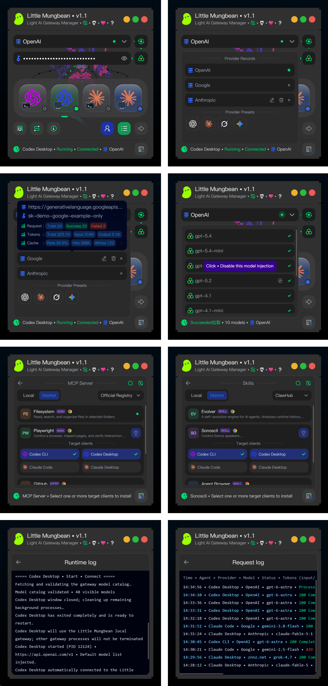

# Little-Mungbean

> [Official website](https://mungbean.cc/en/) • [Documentation](https://mungbean.cc/en/doc.html) • English • [中文](README_ZH.md)

Little Mungbean • A free, open-source, simple, lightweight AI gateway manager that lets Codex and Claude clients share a switchable, observable local gateway with multi-provider management, local protocol conversion, model injection, MCP Server and Skills management, and usage statistics...

## Features

- 🚀 **One-click client installation** • Install Codex CLI, Codex Desktop, Claude Code, and Claude Desktop with one click.
- 💡 **Real-time status detection** • Automatically detect whether Agent clients are installed, running, and connected to the gateway.
- 🛡️ **Secure configuration storage** • API keys are encrypted locally, and the gateway listens only on the local loopback address.
- 🔀 **Multiple providers** • Save multiple provider endpoints and API keys, rename providers, drag to reorder them, and switch between them quickly.
- 🔄 **Provider switching** • After changing a provider endpoint or API key, click **Restart • Connect** to restart the selected Agent client and reload its configuration.
- 🔐 **Account mode switching** • Switch between local gateway mode and the Agent client's official account mode without signing out. Original settings are restored automatically.
- 🔌 **Independent client connections** • Manage installation, running and connection status, and gateway routes separately for all four Agent clients.
- 📊 **Provider usage statistics** • Track request counts and token usage separately for each provider.
- 📥 **Gateway model management** • Fetch model lists from providers and hide outdated or rarely used models for each provider.
- 🗂️ **Model injection** • Choose **Default model list** or **Gateway model list** independently for each Agent client, adding provider models to the client's model list for easy selection.
- 🧩 **Local protocol conversion** • Convert between OpenAI, Anthropic, Gemini, and other supported protocols. Models from the same family are forwarded directly where possible, and conversion can be toggled without restarting. See the FAQ below.
- 🧰 **MCP Server management and market** • Manually add MCP Servers or install them from the market; edit, search, enable, disable, or remove them; use them across multiple Agent clients; and visit their service websites.
- 📚 **Skills management and market** • Manually add Skills or install them from the market; import directories or ZIP archives; edit, search, enable, disable, or remove Skills; use them across multiple Agent clients; and visit their service websites.
- ✂️ **Native text context menus** • Input fields, search boxes, and editors in the main window, MCP Server, and Skills views support undo, redo, cut, copy, paste, and select all using native macOS and Windows menus. About and log views support drag selection, select all, and copy.
- 🖱️ **Client shortcuts and connection details** • Right-click a client card to open its configuration directory or copy the current local connection's **Base URL** and **Token** for use with other tools.
- 📝 **Runtime log** • Record each operation and any error messages.
- 📋 **Request log** • Record Agent clients, providers, models, status codes, tokens, elapsed time, time to first token, request endpoints, and protocol conversion details.
- 🌍 **Chinese and English** • Both the interface and log output support Chinese and English.

## Agent client status lights

- ⚪ **Gray with ×** • Not installed
- ⚪ **Gray** • Not running
- 🔵 **Blue** • Running, not connected to the local gateway
- 🟢 **Green** • Connected to the local gateway

## Provider flow indicators

- ⚫ **Black** • No client is both running and connected to the gateway
- 🟢 **Green** • Each running, connected client has its own green branch; the input flow is green when at least one branch is green. Moving dots do not represent real-time data transfer.

## Usage

1. Open Little-Mungbean and enter an endpoint and API Key, or choose a provider preset.
2. Fetch models and select the model to inject into the Agent client.
3. Select a client and click **Start • Connect**.

After changing the endpoint or API Key, click **Restart • Connect**. Little-Mungbean automatically restarts the related client. Protocol conversion can be toggled independently without restarting the client.

Closing the Little-Mungbean window keeps the local gateway running in the system tray. Choose **Exit** to stop the gateway completely. You must click **Start • Connect** again the next time you use a client.

## Network proxies

Little-Mungbean automatically uses your system proxy for model requests, model lists, markets, and downloads. Usually, enabling **System Proxy** in your proxy app is all you need.

- **Supported proxies** • HTTP, HTTPS, SOCKS4/4a, SOCKS5/5h, and PAC (automatic proxy scripts). Use `socks5h://` to let the proxy resolve destination domain names.
- **Custom settings** • Set `HTTP_PROXY`, `HTTPS_PROXY`, or `ALL_PROXY` before starting Little-Mungbean; lowercase names also work. These override the system proxy for the relevant protocol. Use `NO_PROXY` to bypass the proxy for specified addresses. Local gateway connections always bypass proxies.
- **TUN / VPN** • Routing is handled by your operating system and proxy app; no separate setup in Little-Mungbean is needed.

## Frequently asked questions

### What is local gateway mode?

In local gateway mode, an Agent client such as Claude Code or Codex Desktop connects to Little-Mungbean first. Little-Mungbean then forwards requests to the actual AI provider, including official APIs or third-party gateways.

The local gateway handles protocol conversion, request routing, provider switching, and API Key management, making it easier for different clients to use different models.

### What is account mode?

In account mode, the Agent client connects and chats directly through the signed-in official account of the AI provider. Requests do not use Little-Mungbean’s local gateway route.

### What is protocol conversion?

Protocol conversion translates the API format used by an Agent client into the format supported by the upstream model service, and converts requests and responses in both directions, including streaming responses.

The main formats currently involved in local protocol conversion include:

- OpenAI Chat Completions
- OpenAI Responses
- Anthropic Messages
- Gemini GenerateContent

### When should local protocol conversion be enabled?

Enable it when you need to use a model from a different model family, for example:

- Using Claude, Gemini, or another model family in Codex.
- Using GPT, Grok, Gemini, or another model family in Claude.

### When should local protocol conversion be disabled?

- When you do not need cross-family models.
- When the provider already performs protocol conversion on the server. Disabling local conversion avoids converting the request twice.
- Grok natively supports OpenAI Responses, so local conversion is usually unnecessary when using Grok in Codex.

### Does the gateway stop when the Little-Mungbean window is closed?

No. Closing the window leaves the gateway running in the system tray so connected clients can continue making requests. Choose **Exit** from the tray menu to stop the gateway completely. You must click **Start • Connect** again the next time you use a client.

### Where are API Keys stored?

API Keys are encrypted and stored locally. The gateway listens only on the local loopback address and does not expose a listener on the LAN or public Internet.

### How can I report a bug?

Bug reports: heimen115@gmail.com

## License

This project is released under the [Apache License 2.0](LICENSE).
