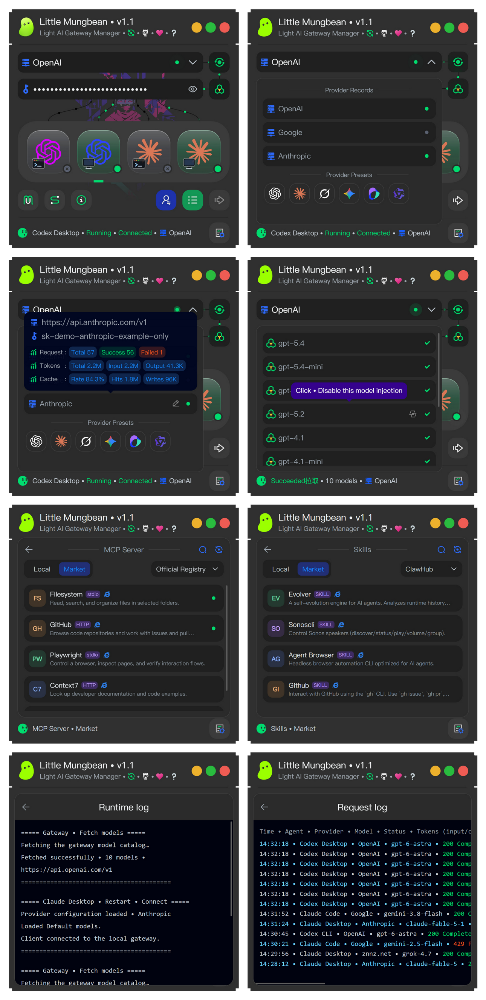

# Little-Mungbean

> English | [Chinese](README_ZH.md)

Little Mungbean • A free, open-source, simple, lightweight AI gateway manager that lets Codex and Claude clients share a switchable, observable local gateway with multi-provider management, local protocol conversion, model injection, MCP Server and Skills management, and usage statistics.

Screenshots below show the Windows interface before the product rename. macOS release and build instructions: [macOS v1.1](docs/macos-release-zh.md), [building](docs/build.md).

On macOS, desktop client installation currently opens the official download page; drag the downloaded app into Applications. The installation buttons support automatic desktop installation on Windows.

## Features

- 🚀 **One-click client installation** • Install Codex CLI, Codex Desktop, Claude Code, and Claude Desktop from Little-Mungbean.
- 🔀 **Multi-provider management** • Save multiple provider endpoints and API Keys, rename entries, reorder them by dragging, and switch quickly.
- 🔄 **Provider switching** • After changing a provider endpoint or API Key, click **Restart • Connect** to restart the selected Agent client and reload its configuration.
- 🔐 **Account mode switching** • Switch between local gateway mode and the client’s official account mode without signing out, while restoring the original configuration automatically.
- 🔌 **Independent client connections** • Manage installation, runtime, connection state, and gateway routing for all four Agent clients separately. On macOS, desktop clients launch through the system application service with their own resource attribution in Activity Monitor. Managed CLI terminal identities survive Little-Mungbean restarts so model lists can be switched again; terminals left by older builds need to be closed once before the first connection with the new build.
- 🧰 **MCP Server management and registry** • Add local MCP servers or install them from the registry; edit, search, enable or disable, and remove servers; manage support for multiple Agent clients; and visit MCP server websites.
- 📚 **Skills management and registry** • Add local Skills or install them from the registry; import directories or ZIP archives; edit, search, enable or disable, and remove Skills; and manage support for multiple Agent clients. Visit Skill websites. To import a ZIP into Claude Desktop, use Customize > Skills. ZIP files are saved to the `Little-Mungbean-Skills` folder in Downloads by default.
- ✂️ **Native text menus** • Right-click the main inputs and the MCP Server / Skills search and editor fields for Undo, Redo, Cut, Copy, Paste, and Select All. Uses native macOS and Windows menus; About and log windows support drag selection, Select All, and Copy.
- 🧩 **Local protocol conversion** • Convert between OpenAI, Anthropic, Gemini, and other protocols locally. Same-family models are preferred for direct pass-through, and conversion can be toggled live. See the FAQ below.
- 📥 **Gateway model management** • Fetch model lists from providers and hide legacy or unused models for each provider.
- 🗂️ **Model mapping injection** • Inject provider models into the Agent client model picker so they can be selected directly.
- 🎛️ **Per-client model lists** • Choose **Default models** or **Gateway models** independently for each client. Apply the selected list on the next **Start • Connect** or **Restart • Connect**. On macOS and Windows, Codex CLI appends `(From endpoint)` to the descriptions of default models that exactly match the fetched gateway catalog.
- 📊 **Provider usage statistics** • Track request counts and Token usage separately for each provider.
- 💡 **Real-time status detection** • Detect whether each Agent client is installed, running, and connected to the gateway.
- 🛡️ **Protected configuration** • API Keys are encrypted locally, and the gateway listens only on the local loopback address.
- 🖱️ **Client shortcuts and connection details** • Right-click a client card to open its configuration directory or copy the **Base URL** and **Token** for its current local connection to use with other tools.
- 📝 **Runtime logs** • Record client startup, connection, restart, model injection, gateway operations, and MCP/Skills changes. Successful startup and restart logs include the local listening address; CLI logs also show configuration and working directories. Copy connection tokens from the client card menu.
- 📋 **Request logs** • Record the Agent, provider, model, status code, Tokens, duration, time to first token, endpoint, and protocol conversion details.
- 🌍 **Chinese and English UI** • Support localized interface text and log output.

## Agent client status lights

- ⚪ **Gray with ×** • Not installed
- ⚪ **Gray** • Not running
- 🔵 **Blue** • Running, not connected to the local gateway
- 🟢 **Green** • Connected to the local gateway

## Provider flow indicators

- ⚫ **Black** • No client is both running and connected to the gateway
- 🟢 **Green** • Each running, connected client has its own green branch; the input flow is green when at least one branch is green. Moving dots do not represent real-time data transfer.

## Usage

1. Open Little-Mungbean and enter an endpoint and API Key, or choose a provider preset.
2. Fetch the models and choose which models should be mapped into the Agent client.
3. Select a client and click **Start • Connect**.

After changing the endpoint or API Key, click **Restart • Connect**. Little-Mungbean automatically restarts the related client. Protocol conversion can be toggled independently without restarting the client.

Closing the Little-Mungbean window keeps the local gateway running in the system tray. Choose **Exit** to stop the gateway completely. You must click **Start • Connect** again the next time you use a client.

## Network proxies

Model forwarding, model discovery, registries, and downloads follow the current proxy policy. `HTTP_PROXY`, `HTTPS_PROXY`, and `ALL_PROXY` (including lowercase names) take precedence per destination protocol; unspecified protocols use system settings. HTTP, HTTPS, SOCKS4/4a, and SOCKS5/5h are supported. Use `socks5h://` for proxy-side destination DNS.

Windows reads the active connection's fixed proxies, exceptions, PAC, and automatic detection settings. macOS uses CFNetwork for HTTP/HTTPS/SOCKS, exceptions, and automatic proxies; its new PAC path still needs real-Mac validation. `NO_PROXY` supports domains, wildcards, ports, and IP networks, and loopback connections always bypass proxies. System changes apply to subsequent requests. Set environment variables before starting Little-Mungbean.

PAC preserves ordered backup proxies and explicit `DIRECT` entries. Only connection-stage failures permit failover; model requests are not replayed after response or streaming failures, and proxy authentication failures do not switch routes. Explicit PAC download or execution errors are reported. When Windows automatic detection finds no PAC, fixed proxies or direct access remain available. TUN/VPN routing is managed by the OS and the proxy software.

External installers such as npm receive a snapshot of proxy settings through environment variables, which cannot fully express per-URL PAC rules. Model requests forwarded by the local gateway still resolve their routes independently.

## Frequently asked questions

### What is local gateway mode?

In local gateway mode, an Agent client such as Claude Code or Codex Desktop connects to Little-Mungbean first. Little-Mungbean then forwards requests to the actual AI provider, including official APIs or third-party gateways.

The local gateway handles protocol conversion, request routing, provider switching, and API Key management, making it easier for different clients to use different models.

### What is account mode?

In account mode, the Agent client connects and chats directly through the signed-in official account of the AI provider. Requests do not use Little-Mungbean’s local gateway route.

### What is protocol conversion?

Protocol conversion translates the API format used by an Agent client into the format supported by the upstream model service, and converts requests and responses in both directions, including streaming responses.

The main formats currently involved in local protocol conversion include:

- OpenAI Chat Completions
- OpenAI Responses
- Anthropic Messages
- Gemini GenerateContent

### When should local protocol conversion be enabled?

Enable it when you need to use a model from a different model family, for example:

- Using Claude, Gemini, or another model family in Codex.
- Using GPT, Grok, Gemini, or another model family in Claude.

### When should local protocol conversion be disabled?

- When you do not need cross-family models.
- When the provider already performs protocol conversion on the server. Disabling local conversion avoids converting the request twice.
- Grok natively supports OpenAI Responses, so local conversion is usually unnecessary when using Grok in Codex.

### Does the gateway stop when the Little-Mungbean window is closed?

No. Closing the window leaves the gateway running in the system tray so connected clients can continue making requests. Choose **Exit** from the tray menu to stop the gateway completely. You must click **Start • Connect** again the next time you use a client.

### Where are API Keys stored?

API Keys are encrypted and stored locally. The gateway listens only on the local loopback address and does not expose a listener on the LAN or public Internet.

### How can I report a bug?

Bug reports: heimen115@gmail.com

## License

This project is released under the [Apache License 2.0](LICENSE).
