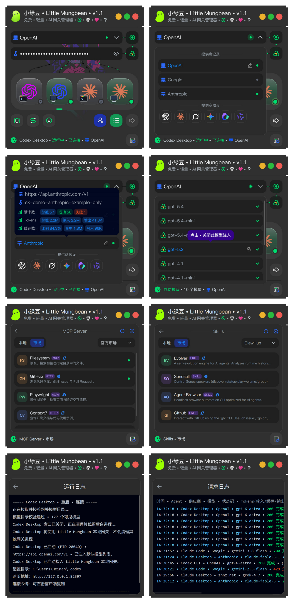

# Little-Mungbean

> [English](README.md) | 中文

小绿豆 • Little Mungbean • 一个免费、开源、简单、轻量的 AI 网关管理器，让 Codex 与 Claude 客户端共享一个可切换、可观测的本地网关，支持多供应商管理、本地协议转换、模型映射注入、MCP Server 与 Skills 管理、用量统计等功能。

下方截图为更名前的 Windows 界面。macOS 正式版说明见 [macOS v1.1](docs/macos-release-zh.md)，构建方法见 [构建说明](docs/build.md)。

macOS 桌面客户端的安装按钮目前打开官方下载页面，下载后手动安装到 Applications；Windows 桌面客户端支持自动安装。

## 主要功能

- 🚀 **客户端一键安装** • 支持一键安装 Codex CLI、Codex Desktop、Claude Code、Claude Desktop。
- 🔀 **多供应商管理** • 保存多个供应商的接口地址和 API Key，支持重命名、拖动排序和快速切换。
- 🔄 **供应商切换** • 切换供应商接口地址或 API Key 后，点击 **重启 • 连接**，重启所选 Agent 客户端并重新加载配置。
- 🔐 **账号模式切换** • 可在本地网关模式与 Agent 客户端官方账号模式之间切换，无需退出账号登录，并自动恢复原始配置。
- 🔌 **多客户端独立接入** • 分别管理四类 Agent 客户端的安装、运行、连接状态和网关路由。macOS 桌面客户端通过系统应用服务启动，在活动监视器中保持独立的资源归属。小绿豆重启后可恢复自有 CLI 终端的管理并继续切换模型列表；旧测试版遗留的终端需在首次使用新版连接前退出一次。
- 🧰 **MCP Server 管理与市场** • 支持本地与市场 MCP Server 手动添加、市场安装、编辑、搜索、开关、移除、多 Agent 客户支持、查看 MCP Server 服务网站。。
- 📚 **Skills 管理与市场** • 支持本地与市场 Skills 手动添加、市场安装、导入 目录/ZIP、编辑、搜索、开关、移除、多 Agent 客户支持、查看 Skill 服务网站。Claude Desktop 通过 Customize > Skills 导入 ZIP；ZIP 默认保存在系统下载目录的 `Little-Mungbean-Skills` 文件夹。
- ✂️ **输入框原生右键菜单** • 主窗口、MCP Server 与 Skills 的输入框、搜索框和编辑框支持撤销、重做、剪切、复制、粘贴与全选，使用 macOS 与 Windows 系统原生菜单；关于和日志窗口支持拖选、全选与复制。
- 🧩 **本地协议转换** • 支持 OpenAI、Anthropic、Gemini 等协议转换；同族模型优先直接转发，并支持热开关。详情见下方常见问题。
- 📥 **网关模型拉取管理** • 从供应商拉取模型列表，按供应商隐藏老旧或不常用模型。
- 🗂️ **模型映射注入** • 将供应商模型注入 Agent 客户端的模型列表，方便直接选择使用。
- 🎛️ **客户端模型列表切换** • 为每个客户端独立选择 **默认模型列表** 或 **网关模型列表**，在下次 **启动 • 连接** 或 **重启 • 连接** 时应用。macOS 与 Windows 的 Codex CLI 使用默认模型列表时，精确匹配网关目录的模型会在原描述后追加 `(From 接口地址)`。
- 📊 **供应商用量统计** • 按供应商独立统计请求数和 Token 用量。
- 💡 **实时状态检测** • 自动检测 Agent 客户端是否安装、运行和连接网关。
- 🛡️ **安全配置保护** • API Key 使用本地加密保存，网关仅监听本机回环地址。
- 🖱️ **客户端快捷操作与连接信息** • 右击客户端卡片，可打开配置目录，或复制当前本地连接的 **Base URL** 与 **Token**，方便搭配其他工具使用。
- 📝 **运行日志** • 记录客户端启动、连接、重启、模型注入、网关操作与 MCP/Skills 变更。启动或重启成功后输出本地监听地址，CLI 还显示配置目录与工作目录；连接令牌可从客户端卡片右键菜单复制。
- 📋 **请求日志** • 记录 Agent、供应商、模型、状态码、Token、耗时、首字延迟、请求端点和协议转换等信息。
- 🌍 **中英文界面** • 支持中文和英文界面及日志输出。

## Agent 客户端状态灯

- ⚪ **灰色（×）** • 未安装
- ⚪ **灰色** • 未运行
- 🔵 **蓝色** • 运行中，未连接本地网关
- 🟢 **绿色** • 已连接本地网关

## 服务商流动光点状态

- ⚫ **黑色** • 没有已启动且连接到网关的客户端
- 🟢 **绿色** • 每个已启动且连接的客户端各自显示绿色支线；至少一条支线为绿色时，输入框流动光点也为绿色。流动光点不代表实时数据传输

## 使用方式

1. 打开 Little-Mungbean，输入接口地址和 API Key，或选择供应商预设。
2. 拉取模型，并选择要映射注入到 Agent 客户端的模型。
3. 选择客户端，点击 **启动 • 连接**。

切换接口地址或 API Key 后，点击 **重启 • 连接**，Little-Mungbean 会自动重启相关客户端。协议转换可以单独热切换，无需重启客户端。

关闭 Little-Mungbean 窗口后，本地网关会继续在系统托盘运行。选择 **退出** 才会完全停止网关；再次使用时，需要重新点击 **启动 • 连接**。

## 网络代理

模型转发、模型列表、市场和下载请求会自动跟随代理设置。按目标协议优先使用 `HTTP_PROXY`、`HTTPS_PROXY` 或 `ALL_PROXY`（也支持小写），未指定的协议使用系统代理。支持 HTTP、HTTPS、SOCKS4/4a、SOCKS5/5h；`socks5h://` 由代理解析目标域名。

Windows 读取当前连接的固定代理、代理例外、PAC 和自动检测设置；macOS 使用 CFNetwork 读取 HTTP/HTTPS/SOCKS、例外和自动代理。macOS 新增 PAC 路径仍需真机验证。`NO_PROXY` 支持域名、通配符、端口和 IP 网段，本机回环连接始终直连。系统代理变更会应用到后续请求；环境变量需要在启动小绿豆前设置。

PAC 保留备用代理及显式 `DIRECT` 的顺序，只在连接阶段失败时尝试下一条路由。模型请求发送后不会因响应或流式传输失败而自动重发；代理认证失败也不会自动切换路由。显式配置的 PAC 下载或解析失败会报错；Windows 仅启用自动检测但未发现 PAC 时，正常回退到固定代理或直连。TUN/VPN 的路由由系统及代理软件管理。

外部安装程序（例如 npm）通过环境变量获得启动时的代理设置，环境变量不能完整表示逐地址 PAC 规则；本地网关转发的模型请求仍会独立解析路由。

## 常见问题

### 本地网关模式是什么？

Agent 客户端(例如 Claude Code、Codex Desktop)先连接到 Little-Mungbean 的本地网关，再由网关将请求转发到真正的 AI 模型服务商，包括官方 API 或第三方中转服务。

本地网关负责协议转换、请求路由、供应商切换和密钥管理，让不同客户端能够更方便地调用不同模型。

### 账号模式是什么？

账号模式下，Agent 客户端直接通过已登录的 AI 服务商官方账号连接和对话，不使用 Little-Mungbean 的本地网关路由。

### 什么是协议转换？

协议转换是指在 AI 网关或代理中，将 Agent 客户端使用的一种 API 格式自动翻译成上游模型支持的另一种格式，并对请求和响应进行双向转换，包含流式响应。

当前涉及的本地协议转换主要格式包括：

- OpenAI Chat Completions
- OpenAI Responses
- Anthropic Messages
- Gemini GenerateContent

### 什么情况需要开启本地协议转换？

当你需要使用跨族的模型时，建议开启本地协议转换，例如：

- 在 Codex 中使用 Claude、Gemini 或其他模型族的模型。
- 在 Claude 中使用 GPT、Grok、Gemini 或其他模型族的模型。

### 什么情况建议关闭本地协议转换？

- 不需要使用跨族模型时。
- 供应商已经提供服务端协议转换时，建议关闭本地协议转换，避免重复转换。
- Grok 原生支持 OpenAI Responses，因此在 Codex 中使用 Grok 通常不需要开启本地协议转换。

### 关闭 Little-Mungbean 窗口后网关会停止吗？

不会。关闭窗口后网关会继续在系统托盘运行，以保持已连接客户端的网络请求。选择托盘菜单中的 **退出** 才会完全停止网关；再次使用时，需要重新点击 **启动 • 连接**。

### API Key 会保存在哪里？

API Key 会在本机加密保存。网关只监听本机回环地址，不对局域网或公网开放监听端口。

### 如何反馈问题？

BUG 反馈邮箱：heimen115@gmail.com

## 开源协议

本项目使用 [Apache License 2.0](LICENSE) 开源。
